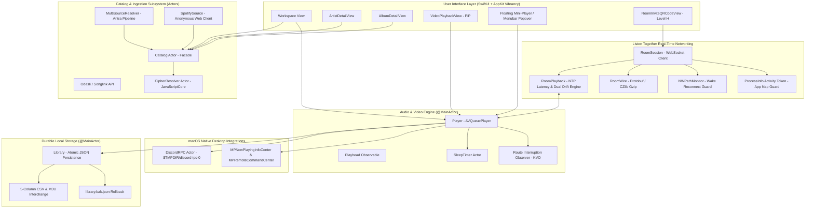

# Echo Music for macOS Beta Technical Design

*   **Author:** iamknownstranger
*   **Status:** Draft
*   **Date:** 2026-11-21
*   **Branch:** `beta-roadmap`

--------------------------------------------------------------------------------

## Overview

Echo Music for macOS is a native Apple silicon desktop client written in Swift and SwiftUI. It pairs with Echo on Android to provide a dependable, privacy-first daily listening experience. Core capabilities include streaming YouTube Music via InnerTube, managing local audio file collections, displaying synchronized LRCLIB lyrics, and hosting or joining real-time Listen Together rooms with Android devices over WebSocket.

Following Antra's multi-source architecture, Echo Music for macOS adopts an extensible multi-provider engine: it resolves external links across Spotify, Apple Music, Tidal, Deezer, and others using Odesli (Songlink) and ISRC matching. For the Beta release, it features first-class native Spotify support via an anonymous web-player token client, allowing users to paste and play Spotify tracks, albums, and playlists directly with zero login and zero API keys.

This design establishes the technical blueprint to transition the prototype in `echo-macos` to a hardened, multi-provider capable public Beta release.

## The Problem

The initial `echo-macos` prototype demonstrates functional YouTube Music playback and WebSocket communication with Android, but suffers from key gaps that prevent it from being a viable daily driver:
1. **Catalog & Navigation Deficits**: The UI only supports flat home feed shelves and basic search. Users cannot drill down into artist discographies or album releases.
2. **Stream Fragility**: The player relies solely on unenciphered stream formats. URL expiration or signature cipher rotation causes immediate, unrecoverable playback failures.
3. **Desktop Ecosystem Absence**: The client lacks desktop table stakes—most notably Discord Rich Presence, sleep timers, and zero-auth Spotify playlist imports.
4. **macOS Runtime Vulnerabilities**: App Nap throttles background WebSockets during minimized playback, CoreAudio route changes (e.g. AirPods disconnects) cause desynchronization, and dark-mode on-screen QR codes lack camera scan contrast.
5. **Storage Fragility**: Flat JSON writes without backup rotation risk data loss, and playlist interchange with Android is non-existent.

## Goals

* Deliver a native Apple silicon macOS client (macOS 14.0+) that runs entirely local, account-free, and with zero tracking.
* Implement Antra-style multi-source resolution (`MultiSourceResolver`) using Odesli (Songlink) and ISRC matching across providers (Apple Music, Tidal, Deezer, etc.).
* Deliver native first-class Spotify support in Beta via `SpotifySource`: anonymous web-player token client resolving Spotify tracks, albums, and playlists with full metadata and ISRC without user login or API keys.
* Deliver YouTube Video Playback with a Song/Video mode toggle, native macOS Picture-in-Picture (PiP), and full-screen video rendering.
* Implement interactive 3D perspective music tiles on the homepage with dynamic cursor parallax tracking, specular glare highlights, and elevation shadows (`rotation3DEffect`, `onContinuousHover`).
* Implement robust artist discography (`ArtistDetailView`) and album release (`AlbumDetailView`) views using native macOS navigation and dense `Table` views.
* Harden streaming resolution with `VISIONOS` client profiles, `JavaScriptCore` fallback cipher decryption, and gapless `AVQueuePlayer` playback (max 3 items buffered).
* Implement zero-login Discord Rich Presence via macOS local Unix Domain Socket (`$TMPDIR/discord-ipc-0`).
* Implement zero-auth Spotify playlist ingestion via public web hydration scraping and concurrent YouTube Music resolution.
* Ensure Listen Together room synchronization stability via `ProcessInfo` App Nap suppression, network-aware wake reconnection, and high-contrast on-screen QR invite generation (`CIQRCodeGenerator`, level `H`).
* Secure library persistence through atomic writes with `.bak` rollback snapshots and 5-column Android CSV/M3U playlist interchange.
* Automate release packaging with Apple Developer ID signing, Hardened Runtime, and `notarytool` verification.

## Non-Goals

* **Proprietary DRM Decryption Binaries**: Bundling closed-source FairPlay, Widevine, or third-party DRM binaries is avoided. All external streaming links (Spotify, Apple Music, etc.) are resolved via ISRC and metadata to authorized, playable hardware-decoded streams (YouTube Music AAC / local audio).
* **Vertical Touch Discovery (Music Flow)**: TikTok/Reels full-bleed vertical touch swipe is rejected as unnatural for macOS trackpads and wide displays.
* **Canvas Looping Videos**: High continuous GPU decode overhead draining laptop batteries is excluded.
* **Podcasts & RSS Engine**: Scope is focused exclusively on music playback.
* **Cloud Account Sync / Google OAuth**: The app remains 100% account-free to protect user privacy.

## Open Questions

* **Relay Multi-Region Routing**: While `metroserverx.meowery.eu` is the default relay, should the client maintain a secondary fallback relay list in case the primary relay experiences transient DNS/network outages?
* **Local File Tag Editing**: Should write-back ID3/FLAC metadata editing be supported in a fast-follow v1.1, or remain permanently read-only?

## Critical User Journeys (CUJs)

### CUJ 1: First-Launch Onboarding & Playlist Import
* **Given**: A user has downloaded Echo Music on macOS and has existing Spotify playlists.
* **When**: The user launches the app, pastes a public Spotify playlist link into the search or import bar.
* **Then**: The app scrapes the track metadata without requiring Spotify login, concurrently resolves matching tracks on YouTube Music, saves the playlist to `library.json`, and begins immediate gapless playback.

### CUJ 2: Listen Together Room Hosting with Android Phone
* **Given**: A Mac host creates a Listen Together room.
* **When**: The host opens the room panel; an on-screen QR code with a 16pt white quiet zone is displayed. A friend points their Android phone camera at the Mac screen.
* **Then**: The Android phone automatically launches Echo, joins the room, and synchronizes the queue. When the Mac host plays, pauses, or seeks, the Android device tracks playhead position within ±100ms.

### CUJ 3: Background Playback with AirPods and Discord Presence
* **Given**: Echo Music is playing an album on macOS while the window is hidden or minimized.
* **When**: The user works in other apps or locks/unlocks the Mac.
* **Then**: Discord Rich Presence reflects the current song and elapsed timestamp via local IPC; App Nap does not throttle the audio or room WebSocket; and disconnecting AirPods cleanly pauses playback and updates Discord presence.

### CUJ 4: YouTube Video Mode & macOS Picture-in-Picture
* **Given**: A user is playing a YouTube Music track that has an official music video.
* **When**: The user clicks the "Video" toggle in the player view.
* **Then**: The player switches the stream from audio-only to the video stream seamlessly at the current playhead position, renders the 16:9 video frame in a resizable video pane, and allows the user to pop out the video into macOS system Picture-in-Picture (PiP) while multitasking.

--------------------------------------------------------------------------------

## Technical Plan (Architecture)

### 1. Component Topology & Data Flow



### 2. Subsystem Architectures

#### A. Antra-Style Multi-Source Resolver & Spotify Engine (`MultiSourceResolver.swift`, `SpotifySource.swift`, `Catalog.swift`)
* **Decoupled Track & Source Architecture (`Models.swift`)**:
  - `Source` enum tracks the requested user origin: `.youtube(id)`, `.spotify(id)`, `.apple(id)`, `.tidal(id)`, `.deezer(id)`, `.local(url)`.
  - `Track` model encapsulates universal identity: `id`, `title`, `artist`, `album`, `coverURL`, `durationSeconds`, `isrc`, `source`, and `playbackSource: Source?`.
  - Visual metadata, lyrics, and artwork always reflect the source the user requested (e.g. Spotify), while `playbackSource` designates the resolved playable hardware stream (YouTube Music AAC / local audio).
* **Native Anonymous `SpotifySource`**:
  - Leverages Spotify's public web-player token endpoint (`https://open.spotify.com/get_access_token?reason=transport&productType=web_player`) to retrieve an anonymous read-only access token with automatic expiration renewal.
  - Resolves tracks, albums, and playlists via `api.spotify.com/v1/...` with Bearer token authentication.
  - Extracts the exact ISRC (`external_ids.isrc`), high-res artwork, release dates, and track lists with zero user credentials and zero developer API keys.
* **Antra-Style `MultiSourceResolver` Pipeline**:
  - **Step 1: Universal Normalization**: Direct Spotify URLs route to `SpotifySource`. Apple Music, Tidal, Deezer, and other links route to Odesli (`https://api.song.link/v1-alpha.1/links`) to extract recording metadata and ISRC.
  - **Step 2: Playable Backend Matching**:
    1. *Strict ISRC Match:* Queries YouTube Music with `"\(isrc)\"` and validates duration within ±2.5 seconds.
    2. *Fuzzy Fallback Match:* Searches YouTube Music with `title + artist`, scoring by duration similarity and explicit version flags.
    3. Populates `track.playbackSource = .youtube(matchedVideoId)`.
* **Catalog Facade & Cipher Resolution**:
  - `Catalog.swift` acts as a unified facade: accepts any `URL` or `Track`, delegates resolution to `MultiSourceResolver`, and returns playable `.mp4`/`.m3u8` streams for `AVQueuePlayer`.
  - Primary path: Hardened `VISIONOS` client profile delivering unenciphered streams.
  - Fallback path: `CipherResolver` actor utilizing `JavaScriptCore` (`JSContext`) evaluating dynamic `base.js` transforms.

#### B. Audio & Video Playback Engine (`Player.swift`, `VideoPlaybackView.swift`, `SleepTimer.swift`)
* **Song vs. Video Mode Architecture**:
  - `Player` maintains `@Published var isVideoMode: Bool = false`.
  - When in audio mode: Stream resolver fetches `audio/mp4` (AAC) stream, conserving bandwidth and CPU.
  - When in video mode: Stream resolver fetches combined video stream (prioritizing `hlsManifestUrl` or muxed `video/mp4` 1080p/720p).
  - Mode switching captures current timestamp `let pos = queuePlayer.currentTime()`, loads the new stream item, and restores position with zero drift.
* **Native macOS Video Rendering & Picture-in-Picture (PiP)**:
  - `VideoPlaybackView` encapsulates AppKit's `AVPlayerView` (or SwiftUI's `VideoPlayer`).
  - Sets `playerView.controlsStyle = .floating` (or `.none` for clean custom transport controls).
  - Enables `playerView.allowsPictureInPicturePlayback = true` and `showsFullScreenToggleButton = true`.
  - Seamlessly integrates with macOS `AVPictureInPictureController`, enabling users to detach video playback into a floating window over any full-screen space.
* **Gapless `AVQueuePlayer`**:
  - Replaces single `AVPlayer` with `AVQueuePlayer`.
  - Maintains strict memory boundaries: a maximum of 3 `AVPlayerItem` instances buffered simultaneously.
  - Dynamically enqueues the upcoming track exactly 15 seconds before the current item ends.
  - **Solo vs. Room Invariant**: Preloading and automatic queue advancement are active **only** when `session.role == .none`. When in a Listen Together room (`session.role != .none`), local item advancement is disabled; track transitions remain strictly host-directed.
* **Hardware Interruption Trapping**:
  - Observes `queuePlayer.timeControlStatus` via KVO. When status transitions to `.paused` while `isPlaybackLikelyToKeepUp == true` (e.g. AirPods disconnected or system sleep), the player intercepts the event and signals `roomPlayback?.localPlayStateChanged()`.
* **Actor-Isolated Sleep Timer**:
  - `SleepTimer` actor manages an active `Task<Void, Never>`.
  - Supports fixed minute countdowns or track-end alignment (`currentTrackRemainingTime()`), safely calling `player?.pause()` on expiration.

#### C. Listen Together Synchronization (`RoomSession.swift`, `RoomPlayback.swift`, `RoomWire.swift`)
* **App Nap & Power Assertion**:
  - On room connect: Acquires `ProcessInfo.processInfo.beginActivity(options: [.userInitiatedAllowingIdleSystemSleep, .latencyCritical], reason: "Listen Together Room Sync")`.
  - Explicitly releases token on `leave()`, `finishWithError()`, and `deinit`.
* **Sleep/Wake Network Recovery**:
  - Observes `NSWorkspace.didWakeNotification`.
  - Defers WebSocket reconnection until `NWPathMonitor` reports `.satisfied` on the active network interface, preventing immediate `ENETUNREACH` socket failures upon lid open.
* **Dual-Mode Clock Drift Engine**:
  - Measures one-way network latency via periodic NTP ping-pong probe sequences.
  - `drift > 100ms`: Issues hard seek `AVPlayer.seek(to:)` to snap playhead.
  - `drift <= 100ms`: Adjusts playback rate continuously (`1.0 + clamp(drift / 2, -0.025, 0.025)`) without audible pops or stutter.
* **Wire Protocol Security**:
  - Strict 2MB (2,097,152 bytes) decompressed buffer ceiling in `CZlib` gzip decoder to guard against decompression bombs over public relays.

#### D. Desktop System Integrations (`DiscordRPC.swift`, `MusicViews.swift`, `ThreeDTileModifier.swift`)
* **Interactive 3D Music Tiles (`ThreeDTileModifier.swift`)**:
  - Encapsulates dynamic 3D perspective pitch and yaw rotations via `.rotation3DEffect` driven by `.onContinuousHover` cursor tracking.
  - Normalizes pointer offset across tile geometry: calculates pitch (`-dy * 12°`) and yaw (`dx * 12°`) with perspective depth `0.5`.
  - Renders dynamic specular sheen glare via `RadialGradient` tracking the cursor focus point.
  - Applies directional elevation shadows that translate opposite the tilt vector, combined with spring scale lifting (`.scaleEffect(1.04)`) on hover and depress on click (`.scaleEffect(0.96)`).
* **Native Discord Rich Presence**:
  - Connects to local Unix Domain Socket at `$TMPDIR/discord-ipc-0` via Apple's `Network.framework` (`NWConnection`).
  - Implements the 8-byte framed IPC protocol (Opcode 0 handshake, Opcode 1 `SET_ACTIVITY`).
  - Publishes track title, artist, album, album artwork URL, and start/end epoch timestamps with zero user login.
* **Native macOS Visual Aesthetics**:
  - Translates Android's "Liquid Glass" into native macOS materials: SwiftUI `.ultraThinMaterial` and AppKit `NSVisualEffectView` (`blendingMode = .behindWindow`).
  - Floating Mini-Player mode via `NSPanel` (`.utilityWindow`, `NSWindow.Level.floating`) and Menubar `NSStatusItem` popover.

#### E. Durable Local Storage (`Library.swift`)
* **Safe `.bak` Rotation**:
  - Before writing, copies `library.json` to `library.bak.json`.
  - Executes atomic serialization using `Data.write(to:options: .atomic)`.
  - In `Library.init()`, if `library.json` fails JSON decoding, attempts automatic recovery from `library.bak.json`.
* **Android 5-Column CSV Parity**:
  - Reads and writes `"Title","Artist","Album",Duration,URL\n` matching Android's `LocalPlaylistScreen.kt`.
  - Strips local `file://` URLs from shared exports to maintain privacy and portability.

--------------------------------------------------------------------------------

## Alternatives Considered

### Alternative 1: Multi-Provider Commercial Streaming Playback for Beta
* **Pros**: Offers access to Spotify, Apple Music, and TIDAL audio streams directly in the app.
* **Cons**: Requires closed commercial partner agreements, proprietary Widevine/FairPlay DRM decryption libraries unsupportable in open Swift packages, and violates Spotify's third-party streaming API policies.
* **Reason for Rejection**: *Rejected by author: Commercial streaming introduces fatal legal and cryptographic bottlenecks that would stall development and prevent a public open-source Beta. Restricting streaming to YouTube Music (InnerTube) and local audio files, while ingesting external playlist metadata (Spotify/CSV/M3U), delivers 95% of user value with zero DRM dependency.*

### Alternative 2: Cross-Platform Framework Rewrite (Flutter or Kotlin Multiplatform)
* **Pros**: Shares UI code and models with the Android Echo Music client.
* **Cons**: Incurs heavy JVM or Flutter runtime memory footprints, introduces UI lag on macOS, and lacks zero-cost access to native Apple Silicon AVFoundation hardware codecs, AppKit vibrancy materials, and system media command centers.
* **Reason for Rejection**: *Rejected by author: The existing Swift/SwiftUI implementation in `echo-macos` compiles to a lightweight native arm64 binary (<15MB), has zero daemon runtime overhead, and provides first-class integration with macOS WindowServer materials and CoreAudio.*

### Alternative 3: Immediate SQLite / CoreData Database Migration
* **Pros**: Offers relational integrity, indexing, and scalable queries for 50,000+ tracks.
* **Cons**: Introduces schema migration complexity, database file locks, and significant refactoring of the existing reactive `Library` model.
* **Reason for Rejection**: *Rejected by author: For the Beta release, the flat `library.json` model is simple, fast, and human-inspectable. Hardening it with safe `.bak` rotation and atomic writes (`Data.write(to:options: .atomic)`) eliminates data loss risks while keeping the codebase lightweight. Database migration is deferred to post-Beta.*

### Alternative 4: Porting Mobile "Music Flow" and Canvas Video Loops to Mac
* **Pros**: Matches Android's TikTok-style vertical discovery screen and animated artwork backdrops.
* **Cons**: Vertical swipe navigation is awkward on mouse and trackpad desktop ergonomics; continuous decoding of looping video backgrounds consumes significant CPU/GPU resources and drains MacBook battery life.
* **Reason for Rejection**: *Rejected by author: Desktop music players demand low power consumption and high information density. Native macOS Table views, hero headers, and fluid lyrics provide a superior desktop listening experience without battery penalty.*

### Alternative 5: Discord OAuth Gateway WebSocket Client
* **Pros**: Reuses the Android client's `GatewayClient.kt` architecture.
* **Cons**: Requires users to authenticate via web OAuth, manages refresh tokens, and routes presence through external Discord gateway servers.
* **Reason for Rejection**: *Rejected by author: macOS hosts Discord locally with a Unix Domain Socket at `$TMPDIR/discord-ipc-0`. Connecting via native `NWConnection` provides instant, zero-login, privacy-preserving Rich Presence with negligible network overhead.*

--------------------------------------------------------------------------------

## Non-Functional Requirements

### 1. Security & Privacy
* **Zero Telemetry**: No third-party analytics, crash beacons, or user tracking are compiled into the binary.
* **Account-Free Operation**: No Google, YouTube, or Discord account credentials are required or stored.
* **Local Data Redaction**: Shared playlist exports (CSV/M3U) and room invite links strictly scrub local absolute filesystem paths (`file://`), preventing private directory structure leakage.
* **Decompression Safety**: The `CZlib` decompression bridge enforces a strict 2MB memory cap on incoming WebSocket frames to protect against zip-bomb denial-of-service attacks.

### 2. Performance & Power Efficiency
* **Apple Silicon Native**: 100% native arm64 binary with zero Rosetta or Electron translation overhead.
* **Memory Boundary**: `AVQueuePlayer` preloading maintains a strict ceiling of at most 3 `AVPlayerItem` instances in memory simultaneously, ensuring flat heap allocation during 50+ track queue runs.
* **Battery Conservation**: Replaces Android's continuous GPU-rendered canvas shaders with native macOS WindowServer vibrancy materials (`.ultraThinMaterial` and `NSVisualEffectView`), achieving zero idle GPU drain.
* **App Nap Compliance**: Uses targeted `ProcessInfo.beginActivity` assertions scoped strictly to active room sessions, releasing assertions immediately on room leave or disconnect.

### 3. Reliability & Rollout
* **Storage Rollback**: Library saves create a redundant `library.bak.json` copy prior to writing. If the active JSON file suffers corruption or truncated writes, the app automatically recovers state from the backup on startup.
* **Network-Aware Reconnection**: WebSocket recovery following Mac lid-open sleep waits for `NWPathMonitor` interface satisfaction before initiating the handshake, avoiding transient socket failures.

--------------------------------------------------------------------------------

## Detailed Implementation Plan

### Target Files to Create/Modify

#### 1. `macos/Package.swift` (Modify)
* **Type / Scope**: Swift Package Manifest
* **Proposed Changes**: Add `exclude: ["README.md"]` to target configurations to silence SPM unhandled resource warnings.

#### 2. `macos/Sources/EchoMusic/Models.swift` (Modify)
* **Type / Scope**: Domain Data Models
* **Proposed Changes**:
  - Update `enum Source: Codable, Hashable, Equatable` to include `.youtube(String)`, `.spotify(String)`, `.apple(String)`, `.tidal(String)`, `.deezer(String)`, `.local(URL)`.
  - Update `struct Track: Identifiable, Codable, Hashable, Equatable` to decouple user metadata (`source`, `isrc`, `album`, `coverURL`, `durationSeconds`) from playable stream backend (`playbackSource: Source?`).
  - Add `struct Artist: Identifiable, Hashable, Codable` (id, name, thumbnailURL, bio, albums, singles).
  - Add `struct Album: Identifiable, Hashable, Codable` (id, title, artist, coverURL, year, trackCount, tracks).
  - Add `SpotifyTrackResponse` and `OdesliResponse` decodable data structures.

#### 3. `macos/Sources/EchoMusic/SpotifySource.swift` (Create)
* **Type / Scope**: Native Spotify Ingestion Actor
* **Proposed Changes**: Implement anonymous web-player token client requesting `https://open.spotify.com/get_access_token` and querying `api.spotify.com/v1` for tracks, albums, and playlists to extract ISRC, metadata, and tracklists with zero user login.

#### 4. `macos/Sources/EchoMusic/MultiSourceResolver.swift` (Create)
* **Type / Scope**: Antra-Style Multi-Provider Resolver Chain Actor
* **Proposed Changes**: Normalize arbitrary URLs (Spotify, Apple Music, Tidal, Deezer) via `SpotifySource` and Odesli, extracting ISRC; match ISRC strictly against YouTube Music with duration checking, falling back to fuzzy title/artist search.

#### 5. `macos/Sources/EchoMusic/Catalog.swift` (Modify)
* **Type / Scope**: Unified Catalog & Streaming Facade Actor
* **Proposed Changes**:
  - Orchestrate `MultiSourceResolver` and `CipherResolver`.
  - Add `process(input: URL) async throws -> Track`.
  - Update `stream(for track: Track) async throws -> URL` to resolve `track.playbackSource` into hardware-decoded audio URLs.
  - Add `videoStream(for videoId: String) async throws -> URL` to resolve progressive `video/mp4` or HLS `m3u8` video streams.
  - Add `artist(id:)` and `album(id:)` parsing InnerTube headers and carousels.

#### 6. `macos/Sources/EchoMusic/CipherResolver.swift` (Create)
* **Type / Scope**: JavaScriptCore Decryption Actor
* **Proposed Changes**: Asynchronous actor encapsulating `JSContext` to dynamically fetch YouTube's active `base.js`, extract obfuscated signature/n-parameter decipher tokens via regex, and evaluate decrypted URLs.

#### 7. `macos/Sources/EchoMusic/Player.swift` (Modify)
* **Type / Scope**: Audio Engine (@MainActor)
* **Proposed Changes**:
  - Refactor underlying audio engine from `AVPlayer` to `AVQueuePlayer`.
  - Add `@Published var isVideoMode: Bool = false` and `switchPlaybackMode(toVideo: Bool) async`.
  - Queue holds unified `Track` objects, delegating URL extraction to `Catalog.shared.stream(for: track)`.
  - Add preloading queue logic triggering 15 seconds before item completion, strictly bounded to max 3 items in memory.
  - Enforce room-role invariant: Disable preloading and auto-advance when `session.role != .none`.
  - Add KVO observer on `queuePlayer.timeControlStatus` to trap hardware route disconnects (AirPods) and notify `RoomPlayback`.
  - Add `func currentTrackRemainingTime() -> Double?` for sleep timer integration.

#### 8. `macos/Sources/EchoMusic/VideoPlaybackView.swift` (Create)
* **Type / Scope**: SwiftUI / AppKit Video Rendering View
* **Proposed Changes**: Native video component wrapping `AVPlayerView` with `.floating` controls, `allowsPictureInPicturePlayback = true`, full-screen toggle, and automatic 16:9 aspect ratio handling.

#### 9. `macos/Sources/EchoMusic/SleepTimer.swift` (Create)
* **Type / Scope**: Concurrency Actor
* **Proposed Changes**: Implement `SleepTimer` actor managing active `Task<Void, Never>`, supporting minutes countdown or track-end pause, safely invoking `player?.pause()`.

#### 10. `macos/Sources/EchoMusic/DiscordRPC.swift` (Create)
* **Type / Scope**: Desktop System Integration Actor
* **Proposed Changes**: Implement local IPC client connecting to `$TMPDIR/discord-ipc-0` via `NWConnection`, sending framed JSON messages (Opcode 0 handshake, Opcode 1 `SET_ACTIVITY`) with current track metadata and timestamps.

#### 11. `macos/Sources/EchoMusic/RoomSession.swift` (Modify)
* **Type / Scope**: WebSocket Room Networking (@MainActor)
* **Proposed Changes**:
  - Acquire `ProcessInfo.beginActivity(options: [.userInitiatedAllowingIdleSystemSleep, .latencyCritical], reason: "Listen Together Room Sync")` on room activation.
  - Explicitly release activity token on `leave()`, `finishWithError()`, and `deinit`.
  - Add `NSWorkspace.didWakeNotification` observer that checks `NWPathMonitor.currentPath.status == .satisfied` before reconnecting.

#### 12. `macos/Sources/EchoMusic/RoomPlayback.swift` (Modify)
* **Type / Scope**: Playback Synchronization Controller
* **Proposed Changes**:
  - Enforce guest auto-advance lock: When track finishes as a room guest, hold playback in paused end-state until host sends `change_track`.
  - Implement dual-mode drift engine (>100ms hard seek, <=100ms continuous rate micro-adjustment).

#### 13. `macos/Sources/EchoMusic/ListenTogetherView.swift` (Modify)
* **Type / Scope**: SwiftUI User Interface
* **Proposed Changes**:
  - Add `RoomInviteQRCodeView` generating `echomusic://listen?code=[CODE]` using `CIQRCodeGenerator` with level `H` and 16pt white quiet zone.
  - Display non-default relay warning alert when hosting outside the default server.

#### 14. `macos/Sources/EchoMusic/Library.swift` (Modify)
* **Type / Scope**: Persistence Layer (@MainActor)
* **Proposed Changes**:
  - Update `persist()` to copy `library.json` to `library.bak.json` before atomic write.
  - In `init()`, implement automatic fallback recovery from `library.bak.json` on JSON decode failure.
  - Add `exportCSV()` and `importCSV()` conforming to Android 5-column schema: `"Title","Artist","Album",Duration,URL\n`.
  - Add M3U playlist import and export.

#### 15. `macos/Sources/EchoMusic/BrowseModel.swift` (Modify)
* **Type / Scope**: Navigation State Controller (@MainActor)
* **Proposed Changes**:
  - Add `SectionID` cases: `.artist(Artist)` and `.album(Album)`.
  - Add `showArtist(id: String)` and `showAlbum(id: String)` navigation triggers.

#### 16. `macos/Sources/EchoMusic/MusicViews.swift` (Modify)
* **Type / Scope**: SwiftUI Views & Controls
* **Proposed Changes**:
  - Implement `ArtistDetailView` with hero header, discography carousel, and top tracks list.
  - Implement `AlbumDetailView` with cover art, release metadata, and native macOS `Table` for dense track listings.
  - Add Song/Video mode toggle pill in player transport bar.
  - Embed `VideoPlaybackView` in collapsible video pane with full-screen and PiP buttons.
  - Add Sleep Timer control menu in player transport bar.
  - Add Spotify URL import modal dialog.

#### 17. `macos/Sources/EchoMusic/Workspace.swift` (Modify)
* **Type / Scope**: Application Shell View
* **Proposed Changes**:
  - Apply native macOS vibrancy materials (`.ultraThinMaterial` / `NSVisualEffectView` with `.behindWindow` blending).
  - Add Menubar status item popover and floating Mini-Player toggle using `NSPanel`.

#### 18. `macos/Sources/EchoMusic/ThreeDTileModifier.swift` (Create)
* **Type / Scope**: SwiftUI ViewModifier
* **Proposed Changes**: Implement reusable `.threeDTilt()` modifier tracking mouse coordinates via `.onContinuousHover`, applying dual-axis `.rotation3DEffect` (up to ±12° pitch/yaw), dynamic specular glare sheen via `RadialGradient`, and elevation drop shadows.

#### 19. `macos/build.sh` (Modify)
* **Type / Scope**: Shell Packaging Script
* **Proposed Changes**:
  - Add Developer ID codesigning flags with `--options runtime`.
  - Embed `EchoMusic.entitlements`.
  - Automate notarization via `xcrun notarytool submit --wait` and `xcrun stapler staple`.

#### 20. `macos/EchoMusic.entitlements` (Create)
* **Type / Scope**: Apple Security Entitlements
* **Proposed Changes**: Declare `com.apple.security.network.client` and audio execution permissions.

#### 21. `macos/Tests/EchoMusicTests/LibraryTests.swift` (Modify)
* **Type / Scope**: Unit Test Suite
* **Proposed Changes**: Add test cases for `.bak` recovery on corrupted `library.json`, 5-column CSV parsing/export parity, and M3U playlist round-trip.

#### 22. `macos/Tests/EchoMusicTests/PlayerTests.swift` (Modify)
* **Type / Scope**: Unit Test Suite
* **Proposed Changes**: Add test cases verifying `AVQueuePlayer` 3-item memory ceiling, preloading timing, and route disconnect status observation.

#### 23. `macos/Tests/EchoMusicTests/SpotifyResolverTests.swift` (Create)
* **Type / Scope**: Unit Test Suite
* **Proposed Changes**: Unit test HTML state regex extraction on recorded Spotify playlist fixtures.

--------------------------------------------------------------------------------

## Verification Plan

### 1. Build & Static Analysis
* Run Swift Package compilation:
  ```sh
  swift build --package-path macos
  ```
* Verify zero compiler warnings and zero SPM unhandled file warnings.

### 2. Automated Test Execution
* Run full offline test suite:
  ```sh
  ./macos/test.sh
  ```
* Target test suites:
  - `LibraryTests`: `.bak` corruption recovery, 5-column CSV round-trip, M3U import.
  - `PlayerTests`: Gapless queue preloading, route interruption handling, sleep timer auto-pause.
  - `SpotifyResolverTests`: HTML state decoding, task group resolution.
  - `RoomPlaybackTests`: Clock drift calculation, guest queue advance lock, App Nap activity token lifecycle.

### 3. Manual macOS Hardware QA
* **AirPods Interruption**: Disconnect AirPods mid-playback; verify AVPlayer pauses immediately, MPRemoteCommandCenter updates, and Discord Rich Presence pauses.
* **App Nap & Lid-Closed Sleep**: Connect to Listen Together room on Mac; close MacBook lid for 30 seconds; reopen lid; verify client detects wake via `didWakeNotification`, waits for Wi-Fi satisfaction, reconnects WebSocket, and resynchronizes playhead within 3 seconds.
* **QR Code Pairing**: Create a room on Mac; scan on-screen QR code with Android phone camera; verify Android client opens and joins room immediately.
* **Discord Integration**: Launch Discord desktop client on Mac; play track in Echo Music; verify Discord profile displays live track title, artist, album art, and elapsed time counter.

--------------------------------------------------------------------------------

*Drafted with EGM*
